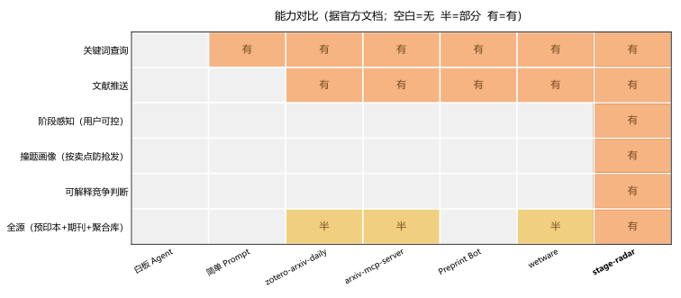
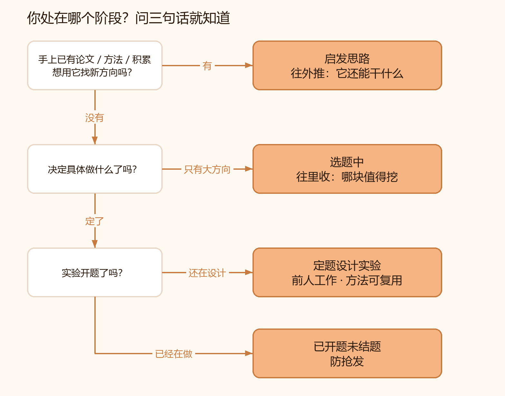
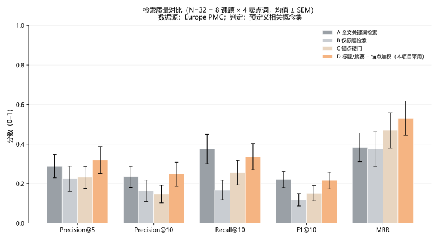
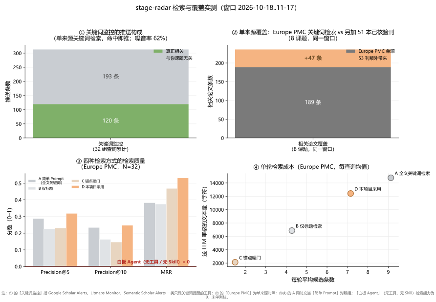
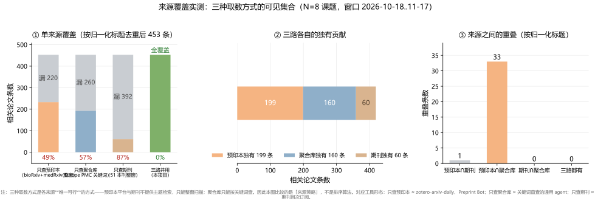
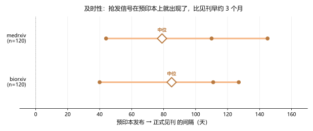
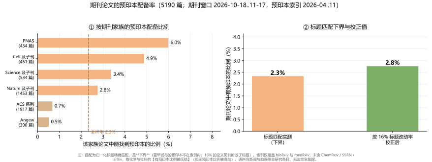
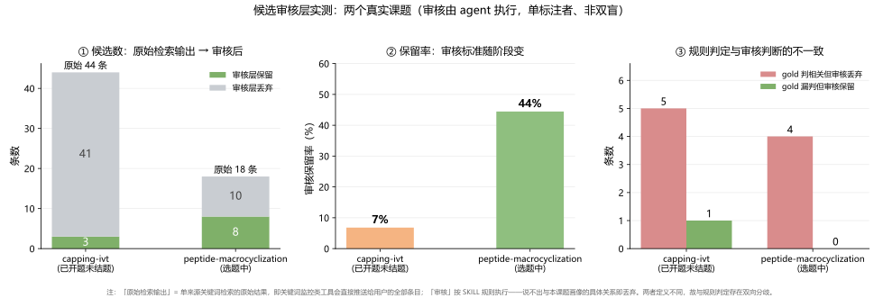

# stage-radar · 阶段雷达

> **从选题到结题的阶段感知文献雷达skill——为「防抢发」而生。**

  

现有文献工具只会「持续推你感兴趣的」。它们**不知道你在哪个研究阶段**，更**不知道你怕什么被抢**——
于是选题时被塞一堆同域论文，开题后被人抢发了才后知后觉。

阶段雷达把两件事合到一起：**目标随阶段切换** + **按你的卖点判竞争威胁**。

而且，你不用填什么关键词表，只用**跟 AI 聊聊**，我们的SKILL能让AI真正了解你的课题后再去预防抢发（˶ᵔ ᵕ ᵔ˶）

---

## 1. 它解决什么问题

快节奏领域（基因编辑、单细胞、合成生物学、人工智能生物交叉……）一篇论文出来几个月内就会被别的组做完后续。
**被抢发 = 一篇论文发不出，一两年白干。**

而现有的工具都停在同一个层面：**关键词查询 + 文献推送**。它们不区分你是在找方向、还是已经开题在赶进度；
也不区分给你推送的那些新论文是「同领域而已」还是「正撞在课题的卖点上」。


| | 别人做的 | 阶段雷达做的 |
|:---|:---|:---|
| 找文献 | 按关键词/兴趣持续匹配 | 按**阶段**换目标函数 |
| 看新论文 | 关键词新论文提醒 | 按**撞题画像**判断该论文「会不会影响用户相应课题发表」 |
| 输入方式 | 让你填关键词 |与AI交互，用**自然语言**就可轻松上手，检索词由 AI 生成 |
| 推送 | 堆砌大量论文 | 每篇附**一句为什么推你** + 威胁档位 |

### 优势：与同类工具的能力差异

**共性**：不论哪一类形态，做的事都是「**按某种依据把论文推给你**」——差异只在**依据**（关键词 / 期刊目录 / 你的文献库 / 引用关系）和**筛选层次**（推不筛 / 先筛再推）。

> 下表只列**能拿到公开实现或文档**的 ①② 类工具；③④⑤ 类（整刊订阅、文献库画像、引文网络）多为商业产品、无公开跑分口径，故只在前文做定性对比，**不进这张矩阵**。

| 能力 | 白板 Agent | A 全文检索 | zotero-arxiv-daily | arxiv-mcp-server | Preprint Bot | wetware | **stage-radar** |
|:---|:---:|:---:|:---:|:---:|:---:|:---:|:---:|
| 关键词查询（共性） | ✗ | ✓ | ✓ | ✓ | ✓ | ✓ | ✓ |
| 文献推送（共性） | ✗ | ✗ | ✓ | ✓ | ✓ | ✓ | ✓ |
| **LLM 对话理解课题** | ✗ | ✗ | ✗ | ✗ | ✗ | ✗ | **✓** |
| **检索词由 AI 生成（用户不填）** | ✗ | ✗ | ✗ | ✗ | ✗ | ✗ | **✓** |
| 阶段感知（用户可控） | ✗ | ✗ | ✗ | ✗ | ✗ | ✗ | ✓ |
| 撞题画像（按卖点防抢发） | ✗ | ✗ | ✗ | ✗ | ✗ | ✗ | ✓ |
| 可解释竞争判断 | ✗ | ✗ | ✗ | ✗ | ✗ | ✗ | ✓ |

竞品的「阶段」不是课题阶段，而是论文关系或写作进度：

| 工具 | 它做的「阶段」 | 局限 |
|:---|:---|:---|
| Connected Papers | Prior works / Derivative works | 按单篇论文二分，非研究项目阶段 |
| ResearchRabbit | Earlier / Similar / Later Work | 同上，非用户可控 |
| Litmaps | Discover / Monitor | 目标函数不切换 |
| [researchclaw-skill](https://github.com/OthmanAdi/researchclaw-skill)（27★）、[paper-writing-skill](https://github.com/YurainSoon/paper-writing-skill)（6★） | 论文**写作**流水线 | 是「写论文」阶段，不是「做研究」阶段 |

竞品的「提醒」也只是新论文提醒：Litmaps Monitor、Google Scholar Alerts、Semantic Scholar Alerts 都是关键词/引用提醒，
**不做竞争相关性判断**。GitHub 检索 `paper alert scoop`、`preprint surveillance alert` 均为 0 结果——
「抢发预警」作为独立工具基本不存在。

**兴趣匹配类竞品**：[zotero-arxiv-daily](https://github.com/TideDra/zotero-arxiv-daily)（6.1k★）、
[arxiv-mcp-server](https://github.com/blazickjp/arxiv-mcp-server)（3.3k★）、
[Preprint Bot](https://github.com/SU-OSPO/preprint-bot)（9★）、[wetware](https://github.com/mmaisel/wetware)（13★）——
全是「持续兴趣匹配」，无阶段、无抢发。

**阶段雷达的差异**：把「阶段感知」与「抢发预警（撞题画像驱动）」组合，并以**对话**而非关键词表作为输入入口。



> 图注：本图为机制对比，依据各项目官方 README 与文档；未做端到端跑分，理由见上方证据等级说明。
> 脚本 [plot_capability.py](./plot_capability.py)。

> **本节的证据等级**：9.1–9.6 为**可复现实测**（脚本随附于 `research/` 与仓库根）；
> 前文的同类工具对比为**机制对比**，未做端到端跑分（理由见前文）。

---


## 2. 快速开始

### 想跑每日推送：下载 SKILL.md

这个仓库里最核心的是 [SKILL.md](./SKILL.md)——**一份写给 AI 看的说明书**。把它交给你的 AI，
它就知道该怎么问你的课题、怎么生成检索词、怎么判断该不该推给你。

**用法就一步：下载 [SKILL.md](./SKILL.md)，交给你的 AI，说「按这个规格帮我搭起来」。**
---

## 3. 它怎么工作

### 3.1 四个阶段，目标函数随阶段切换

阶段**由你显式选择，绝不后台推断**。同一个课题，阶段不同，推的东西完全不同：

| 阶段 | 你是什么状态 | 推什么 |
|:---|:---|:---|
| **启发思路** | **不知道下一步该做什么**（有积累更好，但不必有） | 广泛推送新论文、重要论文和有颠覆性结论论文，希望能启发到在思考中的用户；**你别的领域的积累也算数**（交叉往往正是独特优势） |
| **选题中** | 有宽泛方向，还没定题 | **大范围铺开**，覆盖多个可能选题 |
| **定题设计实验** | 定了题，在设计实验 | 前人工作 / 类似思路 / **方法可复用** /实验技术方法|
| **已开题未结题** | 开题后、赶进度 | **防抢发**：谁可能已经抢在你前面发文，为什么被判定为抢发。这也是本Skill的主打功能 |

`选题中 → 定题设计实验` 是**强制关卡**：必须由你主动告知选题，Skill 先做**无重合核查**（已发表 + 预印本 + 推进中课题组），没有重合才放行。

**“要选阶段时，AI辅助判断”**

AI 会问**你卡在哪一步**（而不是"你手里有什么"），理解后让你确认：

```
Ⓐ 还不知道下一步该做什么            → 启发思路（往外扩）
Ⓑ 知道大致方向，但不知道选哪个切口  → 选题中（往里收）
Ⓒ 已经定了具体题目                  → 再看实验开题没有
```

**"有没有前期积累"会单独问一句，但它不决定阶段**：有积累也可能不知道下一步做什么；
零积累也可能已经定了方向只想挑切口。



**推送怎么设置由用户选择**：每个课题单独设置推送时间——每天？每周？还是你问的时候再推送？都可以

（注意，本SKILL默认：**启发思路、防抢发**两个阶段每天推送打开；**选题中、定题设计实验关**两个阶段每天推送关闭，但你随时能改。）

**「启发思路」可以多方向并行**——即支持几个需要启发思路的方向都挂上每天推送。

### 3.2 撞题画像：按你的卖点判威胁，不是按课题外形

一个课题的价值 = 「新颖性点（**卖点子**）」+「技术工程化点（**卖实现**）」。
据此把「怕被抢」分成三圈，**可以由你自己描述，也可以由AI判断**：

- **致命圈** —— 命中这个，你的卖点就没了 → 高威胁
- **降档圈** —— 命中这个，你的文章要降一档 → 中威胁
- **无关圈** —— 命中这个不影响你 → 直接过滤

**撞题 = 命中卖点，不是命中课题外形。**

> 那些只靠用户自己填写关键词的竞品，只会大规模却没抓手的搜索，最后推送一大批文章却没有切中要害，白白浪费你的时间。但与它们相比，本产品很好的利用了AI的优势，让AI真正理解课题。比如课题「用 PE 治罕见病腓骨肌萎缩症」，让AI理解后，AI就能很好地区分以下情况：搜索到其他课题组发出「用 PE 治黑色素瘤」的文章→ 无视；搜索到其他课题组发出「换方法做到了同一个病」的文章→ 降档圈。

### 3.3 跟 AI 对话，而不是填关键词

这是它和「关键词监控」最根本的区别：

- 你用自己的话讲**研究动机、想怎么做、最怕什么出现**；
- AI **一轮一轮追问**，帮你把目的、差异化卖点、三圈理清楚；
- 你说「不知道」，AI 会**主动铺候选让你挑**，绝不把球踢回给你；
- 检索词由 AI 生成，**无需手动构造关键词**；
- **一次只问一个问题**——不把一堆问题堆在一段话里，让你一次答一个；
- **能用选项按钮就用**；但**开放值不硬塞选项**——时间、邮箱这类只给一个默认，让你自己写。

最终档案经你逐步确认后才生效；**AI 的提案必须经过用户确认**。

### 3.4 会话有历史记忆

因为skill借助AI工具发挥作用，所以最终**只有一个对话框**。

所以除了聊天记录正常的历史记忆外，「选题中」「定题设计实验」这两个会话阶段的产出**会特地写成文件存下来**，不会只留在聊天记录里——
你可以搁置几天再回来说一句「继续 <课题> 的选题」，它就接着上次往下走，**不用你翻历史、也不用复述**。

注意：
想看全部课题的状态，问一句「**我的课题都怎么样了**」即可，它会给一张表。

| 课题 | 阶段 | 每日推 | 上次可靠结算 | 上次产出 | 待办 |
|:---|:---|:---:|:---|:---|:---|

### 3.5 防抢发：全源最新 + 可解释竞争

- **不只盯预印本**：同一篇相似工作不管出现在 bioRxiv、期刊最新一期还是聚合库，都要被捞到。
- **每篇必须有竞争解释**：说不出「为什么可能与你竞争」的，**按篇丢弃**——
  且**不整批拒收**（整批拒收会让一次笔误吞掉整轮推送，还会被显示成「今天没有新文章」）。
- **日期分三栏**：投稿（received）/ 在线公开 / 见刊，取不到就写「未取得」，**不拿接收年份或抓取日期冒充新发表**。
- **不夸大覆盖**：本轮实际查了哪些源、哪些源 0 篇、哪些源没查动，**逐源如实列出**（见 §4）。

### 3.6 多课题并行

不是「全局一个阶段」，而是**课题组合（portfolio）**：支持同时有多个课题并行
每个课题**独立建档、独立阶段、独立去重与打分历史**。

### 3.7 推送

**目前可选择的推送方式**（飞书 / 邮件 / 本地）
**推送时间**用户自行设定，默认每天上午9：00

确认「开始」后，**AI 会主动把定时器建好**，不用你自己去设计划任务；你可以对话暂停定时器。

本SKILL在新增推动通道时会先发一条**不含课题信息**的测试消息，以免泄露个人课题信息
你确认收到后才发真实内容。

### 3.8 推送长什么样

下面是**真实投递内容**（取自一次实际运行的记录，仅作展示）：

```
【环肽合成方法学：自由基/高分子策略的高浓度肽环化｜阶段雷达】
检索时间：2026-11-18T10:26:14+08:00
说明：候选圈需结合全文复核；不是标题一命中就宣布被抢发。

#1 Visible-light driven macrocyclization of peptides: from a vinyl to an α-selenoketone motif.
TL;DR（这篇文章做了什么）：报道一种可见光驱动的肽大环化：把线性肽的乙烯基前体化学选择性
转化为带 α-硒代酮基元的环肽，反应在水相、温和条件下进行。
为什么推你：与本课题同属成环方法学。它给出一条光驱动、水相、化学选择性的成环路线，
可作为我们自己环化方案的候选设计直接比较。
候选圈：方法可迁移｜威胁：高
投稿：未取得｜在线公开：2026-10-28｜见刊：未取得
期刊论文｜Europe PMC（期刊+预印本）、PubMed
链接：https://pubmed.ncbi.nlm.nih.gov/42865116/

#2 SuFEx Cyclization Enables DNA-Encoded Macrocyclic Peptide Libraries for Drug Discovery.
TL;DR（这篇文章做了什么）：报道基于硫(VI)氟交换（SuFEx）的 DNA 上大环化，用于构建超大
环肽文库与 DNA 编码库（DEL）。
为什么推你：与本课题高度相关：把成环反应做到 DNA 兼容、可用于高通量建库，是环化方法
走向文库规模的关键一步。
候选圈：方法可迁移｜威胁：高
投稿：未取得｜在线公开：2026-11-01｜见刊：未取得
期刊论文｜Europe PMC（期刊+预印本）、PubMed
链接：https://pubmed.ncbi.nlm.nih.gov/42984023/

本轮接入 5 个来源（共 9 次查询），成功 9 次。来源：bioRxiv、Crossref 刊源（51 本已核验刊）、
Europe PMC（期刊+预印本）、medRxiv、PubMed。
回到产品 AI / APP 给文章打分：#1 符合｜#3 不符合｜#2 加大类似
```

**每条都带四样东西**：一句中文学术概述（这篇文章做了什么）、一句"为什么推你"、
命中圈与威胁档位、以及**投稿 / 在线公开 / 见刊三个日期**（取不到就写「未取得」，不编造）。

**末尾一行是打分入口**：在你使用的AI平台回复编号即可回流反馈，用于调整下一轮查询。

**当某轮没有候选、或部分来源失败时**，文案会明确区分：

```
今日暂未发现符合您当前课题画像的新论文或新预印本。……          ← 全部来源查完，确实没有
本轮部分来源未完成，不能算作「没有新文章」。……                ← 有来源失败，不算作查无
```

---

## 4. 论文来源

注：**没列出来的，就是没接入的**；未核验的源不得当作已覆盖。
本Skill检索论文源主要分为以下两类
| 类型 | 是什么 | 接入方式 |
|:---|:---|:---|
| **期刊刊源** | 单本期刊，各有 ISSN | 按 ISSN 查 Crossref |
| **平台 / 聚合库** | Europe PMC、PubMed、bioRxiv 这类平台 | 各自的官方 API |

本Skill支持**在对话里增删**论文来源：
如果有需要的话，你可以直接在自己的AI工具中用自然语言让你的AI加入你感兴趣的论文期刊来源，由实现侧发真实请求核验、经你确认后才写入。
Skill中特地规避了作者已经摸索到的一些可能坑点：
若实现侧核验不通过的期刊看源一律不会自行加上；
刊名与返回不一致将会提示用户当前情况；
只有刊名没有 ISSN 时也**不会凭名字猜刊**，规避AI幻觉
……

### 期刊来源（53 刊 + 4 协议，全部逐条核验）

53 刊 + 4 协议**已全部接入每日推送**（协议默认仅在「定题设计实验」阶段启用）。
我们保证我们的杂志源相对全面，当然你也可以下载本skill，接入你的AI工具后，自然语言要求AI加入你感兴趣的杂志源。

核验方式：`GET https://api.crossref.org/journals/{ISSN}/works`，结果带回**该刊实际刊名**。

**Nature 系（Springer Nature）· 18 本**
Nature `0028-0836` · Nature Methods `1548-7091` · Nature Biotechnology `1087-0156` · Nature Biomedical Engineering `2157-846X` · Nature Communications `2041-1723` · Nature Genetics `1061-4036` · Nature Chemical Biology `1552-4450` · Nature Catalysis `2520-1158` · Nature Medicine `1078-8956` · Nature Cell Biology `1465-7392` · Nature Materials `1476-1122` · Nature Physics `1745-2473` · Nature Nanotechnology `1748-3387` · Nature Microbiology `2058-5276` · Nature Ecology & Evolution `2397-334X` · Nature Metabolism `2522-5812` · Nature Aging `2662-8465` · Nature Synthesis `2731-0582`

**Cell Press 系（Elsevier）· 14 本**
Cell `0092-8674` · Molecular Cell `1097-2765` · Cell Reports `2211-1247` · Cell Stem Cell `1934-5909` · Cell Metabolism `1550-4131` · Immunity `1074-7613` · Neuron `0896-6273` · Cancer Cell `1535-6108` · Cell Host & Microbe `1931-3128` · Cell Chemical Biology `2451-9456` · Cell Genomics `2666-979X` · Cell Reports Physical Science `2666-3864` · Cell Reports Methods `2667-2375` · One Earth `2590-3322`

**Science（AAAS）系 · 5 本**
Science `0036-8075` · Science Advances `2375-2548` · Science Signaling `1937-9145` · Science Translational Medicine `1946-6234` · Science Robotics `2470-9476`

**ACS 系 · 11 本**
JACS `0002-7863` · ACS Catalysis `2155-5435` · ACS Nano `1936-0851` · Accounts of Chemical Research `1520-4898` · Chemical Reviews `0009-2665` · ACS Central Science `2374-7943` · ACS Applied Materials & Interfaces `1944-8244` · Organic Letters `1523-7060` · Inorganic Chemistry `0020-1669` · Biochemistry `0006-2960` · JCTC `1549-9618`

**Angew（Wiley）· 2 本**：国际版 `1433-7851`（默认开）· 德文版 `0044-8249`（默认关，与英文版 DOI 大量重叠）

**PNAS · 1 本**：`1091-6490`（单一刊物，无子刊家族；两个 ISSN 指向同一记录，只登记一次）

**Vita（高等教育出版社）· 2 本**：Vita `2097-7468`（已核验，76 条 DOI）· Vita Microbiology `2097-8324`（**尚未收录，暂不可用**）

**协议 / 方法 · 4 本**：Nature Protocols `1750-2799` · STAR Protocols `2666-1667` · CSH Protocols（冷泉港）`1559-6095` · Bio-protocol `2331-8325`（均 Crossref 已核验；默认仅「定题设计实验」阶段启用）

### 平台与聚合库（8 个，状态全部来自真实探测）

| 平台 | 接口 | 时间窗 | 状态 |
|:---|:---|:---|:---|
| Europe PMC | 官方 API（免费） | 服务端日期窗 | ✅ 已核验 |
| PubMed | E-utilities（免费） | 服务端日期窗 | ✅ 已核验 |
| OpenAlex | 官方 API（免费） | 服务端日期窗 | ✅ 已核验 |
| bioRxiv | 官方 API（免费） | 服务端日期窗 | ✅ 已核验 |
| medRxiv | 官方 API（免费） | 服务端日期窗 | ✅ 已核验 |
| arXiv | 官方 API（免费） | 服务端日期窗 | ✅ 已核验（生物题产出稀疏） |
| ChemRxiv | Crossref 按 DOI 前缀（免费） | 服务端日期窗 | ✅ 已核验（**仅元数据**，无摘要） |
| ScienceDirect | 需订阅授权 | — | ❌ **不接入**（见下） |

一些提醒：
> **arXiv 为什么标「生物题产出稀疏」**：它能按日期窗查，但同一周的整个生物分子类只有十几条，
> 而同一周的 arXiv 全库有八千多条。它对 CS / 物理 / 数学题有用，对湿实验生物题近乎为空。
> **为什么 ChemRxiv 走 Crossref**：它自己的公开接口对程序请求一律拒绝。
> 可用的替代路径是按 DOI 前缀查 Crossref —— 代价是只拿到标题、DOI、日期，拿不到摘要。
> 对"防抢发"够用（抢发信号只需要标题和日期），对"理解竞争点"需要额外抓页面。
> **为什么 ScienceDirect 判定为不接入，而不是待办**：它需要付费凭据，
> 走免费的 Crossref。本产品的判据是标题与日期，Crossref 已经给得到，用不上 ScienceDirect 的全文。
> **预印本排在最前的原因**：论文先挂预印本，几个月后才正式见刊。
> 抢发信号最早出现在预印本上——只盯非预印本期刊等于只看过去发生的事。

---

## 5. 隐私与失败边界

**具体课题绝对不外传**：原始课题描述原文、种子全文、你自己的 paper 全文、笔记、本地文件，**都不离开本机**。
只向文献 API 发送**聚合后的查询文本**（关键词 / 概念 / 方法名 / 对象名 / DOI）。

**云端须授权**：如果你选择云端 LLM 协助理解，会先明确告知所选模型与数据范围并获得同意；
你也可以改用本地模型。**不授权则不提供伪装的离线「AI 理解」。**

**检索结果不臆造。** 窗口内确无新文献时，报告「无命中」；存在未取回的来源时，列明具体来源并自动重跑同一窗口，直至完整覆盖；未执行与执行失败同等处理，不作静默。

单一来源无命中，仅代表该来源在本窗口内无结果，不代表该来源失效，亦不代表其他来源无结果。投递失败时仅重试失败通道，不重复投递已成功的通道。无重合核查发现重合时，如实列出风险并拒绝放行。

---

## 6. 仓库结构与文档

| 路径 | 内容 |
|:---|:---|
| [SKILL.md](./SKILL.md) | **核心规格**：六条铁律、阶段模型、课题档案、关卡、执行流程、刊源目录、诚实边界、投递规格 |
| [调研报告.md](./调研报告.md) | 竞品调研与空白定位 |
| [最小验证方案.md](./最小验证方案.md) | 最小可验证路径 |
| [LICENSE](./LICENSE) | MIT |
| [benchmark.py](./benchmark.py) | 检索基准：四组检索方式对照、真 pooling、统计检验、成本计量 |
| [benchmark_results.json](./benchmark_results.json) | 上述基准的**原始结果**（可复现凭据） |
| [plot_benchmark.py](./plot_benchmark.py) | 基准作图 → `benchmark_summary.svg` |
| [plot_capability.py](./plot_capability.py) | 能力对比矩阵作图 → `capability_matrix.svg`（用于 §1「优势」） |
| [sources_catalog.json](./sources_catalog.json) | **刊源机读目录**：55 本期刊 + 4 本协议（ISSN / 接入路由 / 核验状态 / 核验日期） |
| [data/benchmark_journal_corpus.json](./data/benchmark_journal_corpus.json) | 51 本刊的语料快照（6.1 MB），§9.3 / §9.5 的输入 |
| [research/](./research/) | **§9 的实验代码、数据与图**，含运行说明、复现步骤与已修正的测量错误清单 |
| [docs/](./docs/) | 阶段判断流程图（「你处在哪个阶段？问两句话就知道」）：[显示用 PNG](./docs/stage-flow.png) + [可编辑 SVG 源](./docs/stage-flow.svg) |
| [tools/draw_stage_flow.py](./tools/draw_stage_flow.py) | 重画阶段流程图（改顶部坐标区即可，SVG 与 PNG 同时更新） |


---

## 7. 📱 App 版本 Mobile App

本产品还延伸开发出了一个**原生 Android app 版本**。目前该app仍在优化中……

它和本仓库的 Skill 规格**同种模式——LLM 对话交互**：
你可以在app中用自然语言讲课题，AI 追问并生成检索词，而不是让你手填关键词。
它是一个**独立运行的产品**，但如果用完本仓库skill觉得好的话，那你绝对应该试试这款app。
十分欢迎使用，并期待提出建议和意见，app也是作者的心血。

**app优势**

- **不需要电脑开着。** 检索、中文审核、通知都在手机上本地完成，电脑关机也照常按点推送。
- **同一种交互，随身可用。** 聊天建课题、改阶段、看文献卡片、给文章打分，都在手机上做。
- **手机原生体验。** 本地通知（角标 + 未读数）、文献卡片、四段阶段条都是原生控件，不是套壳网页。
- **刊源能在手机上直接改。** 53 本期刊 + 4 本协议分组订阅，**还能直接对话让 AI 顾问去找刊**——AI 提议、App 真实核验、你确认后才接入。
- **本地优先。** 课题档案、对话历史、推送凭据只存手机本地，不上云。

**注意**

- 电脑端与手机端是**两套本地产品**，各自独立建档，**不是双向同步**。
- 手机端后台任务走 Android `WorkManager`，**系统省电策略可能推迟**执行时间——写的是「每天 9:00」，不保证整点送达。
- iOS / 鸿蒙版本尚未实现。

---

## 8. 引用与致谢

- **本项目自己设计的三点**：① 阶段感知的目标切换；② 撞题画像（致命 / 降档 / 无关三圈）；
  ③ 可解释竞争判断（每篇一句「为什么竞争」+ 威胁档位）。

  **核查口径（可复现）**：GitHub 按 5 组关键词检索（`literature radar research stage`、
  `stage-aware paper recommendation`、`scooped paper detection research` 等）→ **命中 0 个相关仓库**；
  OpenAlex 检索「stage-aware literature recommendation」类表述 → 无相关方法论文献；
  逐站探测五类代表工具（见上面「对照设置」）→ **无一有阶段概念**。
  表明：**「截至 2026-11，在公开可查的同类工具中未见相同设计」**。
- **借鉴的思路**：bear-scoop 的「邻近程度地图」思路，本工具把它做成**随阶段切换投影轴的共享输出原语**；「本地优先」理念参考 [Home Assistant](https://github.com/home-assistant/core)。
- **致谢**：感谢🙏深势科技 波尔科学空间提供 API 额度（套餐）支持

## 9. 后记：本skill的机制选择思路

**对照设置**：

**我们实际考察了哪些工具**（机制依据各项目官方 README 与文档，逐站探测于 2026-11）：

| 取数形态 | 代表工具 | 取数方式 | 输出形态 |
|:---|:---|:---|:---|
| ① 仅预印本 | [zotero-arxiv-daily](https://github.com/TideDra/zotero-arxiv-daily)（6.1k★）、[arxiv-mcp-server](https://github.com/blazickjp/arxiv-mcp-server)（3.3k★）、[Preprint Bot](https://github.com/SU-OSPO/preprint-bot)、[wetware](https://github.com/mmaisel/wetware) | 只查 arXiv 或 bioRxiv/medRxiv | 新预印本提醒 / 相似度日报 |
| ② 单来源关键词检索 | Google Scholar Alerts、Litmaps Monitor、Semantic Scholar Alerts | 一个库里按关键词查 | 命中即提醒 |
| ③ **整刊订阅（全期刊 TOC 推送）** | [Stork 文献鸟](https://www.storkapp.me/)、[X-MOL](https://www.x-mol.com/)、JournalTOCs、BrowZine、ReadCube、出版社原生 alert | 按刊订阅，新一期目录整刊推给你 | 整刊目录邮件 |
| ④ **靠用户自己的文献库判断** | zotero-arxiv-daily（读你的 Zotero 库）、Paperpile | 以你已收的论文为兴趣画像 | 相关新论文推荐 |
| ⑤ 引文网络扩展 | [Connected Papers](https://www.connectedpapers.com/)、[Litmaps](https://www.litmaps.com/)、[ResearchRabbit](https://www.researchrabbit.ai/)、[Inciteful](https://inciteful.xyz/) | 沿引用关系爬 | 关系图 / 邻域列表 |

**五类之中，仅 ① 与 ② 可用于可量化对照**——二者均输出一份「新命中清单」，可与本项目的输出逐篇比较。③④⑤ 仅作定性对比，不给出量化指标：

- **③ 整刊订阅**：覆盖最完整，但**不作筛选**——单期刊物即推送数十篇，需人工逐篇判读。它解决「不漏」，不解决「哪篇与我相关」。
- **④ 文献库画像**：思路最接近本项目，但**冷启动依赖用户已有大量收藏**，且不区分研究阶段，亦不判断竞争关系。
- **⑤ 引文网络**：适用于**追溯**（引用与被引用），不适用于**盯新**——新文献尚无引用关系可供爬取。

**五类的共同缺口**：均不具备研究阶段感知能力，亦均不回答「该文献是否构成竞争」。这正是本项目的定位所在。


> **图例与图注的约定**：图上标注的是**检索方法**（如"只查预印本"），不是产品名——一根柱子代表一种取数策略，不代表某个具体工具。
> 方法对应的工具形态，写在每张图下方的小字注里。

### 9.1 检索方式的对照选择：全文 / 仅标题 / 锚点硬门 / 标题或摘要＋锚点加权



**结论：采用 D（标题或摘要检索 + 锚点加权排序）。** 与 A（全文检索）相比，
精确率与召回率的差异均不显著（P@10 **+0.012**，95% CI [−0.034, +0.056]；R@10 **−0.038**，CI [−0.148, +0.072]），
首位命中**显著更优**（MRR **+0.148**，CI [+0.052, +0.258]），送 LLM 审核的文本量**少 16%**。

| 指标 | A 全文检索 | B 仅标题 | C 锚点硬门 | **D（本项目采用）** |
|:---|---:|---:|---:|---:|
| Precision@5 | 0.288 | 0.225 | 0.231 | **0.319** |
| Precision@10 | 0.234 | 0.163 | 0.147 | **0.247** |
| Recall@10 | **0.374** | 0.168 | 0.255 | 0.336 |
| F1@10 | **0.221** | 0.118 | 0.152 | 0.215 |
| MRR | 0.383 | 0.375 | 0.469 | **0.531** |
| 平均候选数 | 9.1 条 | 4.3 条 | 1.5 条 | 7.2 条 |
| 送审文本量 | 14,769 字符 | 6,870 | 2,122 | **12,420** |

> 图注与表注：数据源 Europe PMC；固定窗口 `2026-10-18 .. 2026-11-17`，8 个课题 × 4 个卖点词 = 32 组。
> **A** = 卖点词在标题/摘要/正文任意位置命中；**B** = 仅标题；**C** = 标题须**同时**含课题锚点与卖点词（硬门）；
> **D** = 标题**或**摘要命中即可，含锚点者排序靠前。
> 「白板 Agent」（未接入任何检索工具）检索能力恒为 0，属**架构性结果**，未单列柱。
> 指标：**P@k** = 前 k 条中相关文献占比；**R@10** = 窗口内相关文献的召回比例；**MRR** = 首条相关文献排名的倒数均值。

> **对照命名口径**：A 组不再称「简单 Prompt」，而直接称**全文检索**。
> 因为一句「检索相关文献」的指令**本身不产生精确性**——它实际生效的机制就是全文检索，
> 把它叫「简单 Prompt」会让人误以为它是个弱基线。它是一个**机制明确的强召回方案**。

**两项测量边界**：

- **召回率的分母是「四方案候选池」内的相关总数，而非真实全集。** 撒网最宽的 A 因此在该指标上**结构性占优**；
  四个方案均未捞到的相关文献不计入分母。**A 的 0.374 应理解为池内召回，不是全集召回。**
- 32 组、8 个课题，仅足以支撑「差异不显著 / 显著更优」级别的判断，**不足以宣称全面优于任何一种方式**；
  相关性由预定义概念集**规则标注**，非人工评分。**耗时未纳入对比**——实测波动 2.4–14 s，主要由网络负载决定。

脚本 [benchmark.py](./benchmark.py) 与 [plot_benchmark.py](./plot_benchmark.py)。

### 9.2 关键词监控的推送构成：命中文献的相关性比例



**结论：该形态的推送中约六成与课题无关，近六分之一的查询一无所获。**
它不区分课题画像，也不作排序与审核，**筛除成本全部由用户承担**。

| 项 | 数值 |
|:---|---:|
| 累计推送 | 313 条 |
| 真正相关 | 120 条 |
| **无关占比** | **61.7%** |
| 平均每组查询 | 需阅读 9.8 条，得到 3.8 条相关 |
| 返回 0 条的查询 | 5 / 32（15.6%） |

> 图注：对同一批 32 组查询，按「单来源关键词检索、命中即推送」形态取前 20 条逐条判定相关性。
> 对应 Google Scholar Alerts / Litmaps Monitor / Semantic Scholar Alerts 一类工具形态。
> 脚本 `research/exp_keyword_noise.py`，数据 `research/data/keyword_noise_summary.json`。

### 9.3 来源覆盖：三类取数方式的集合重叠与遗漏



**结论：三路的可见集合几乎不重叠，因此同时保留预印本、期刊与聚合库三路。**
单一来源不是「覆盖少一点」，而是**结构性地看不到另一批文献**。

| 取数方式 | 可见相关论文 | 遗漏 |
|:---|---:|---:|
| 只查预印本（bioRxiv + medRxiv 整窗） | 233 条 | **49%** |
| 只查聚合库（Europe PMC 关键词） | 193 条 | **57%** |
| 只查期刊（51 本刊整窗） | 61 条 | **87%** |
| **三路并用** | **453 条** | — |
| 两两重叠 | 预印本∩期刊 **1**；预印本∩聚合库 **33**；期刊∩聚合库 **0** | — |

> 图注：同一窗口、同一批 8 个课题，按**归一化标题**去重后取并集。三种方式是各来源**唯一可行**的取数方式——
> 预印本平台与期刊不提供主题检索，只能整窗扫描；聚合库只能按关键词查询。因此本表比较的是**来源策略**，不是排序算法。
> 工具形态对应：只查预印本 ≈ zotero-arxiv-daily / Preprint Bot；只查聚合库 ≈ 关键词直查的通用 agent；只查期刊 ≈ 期刊目次订阅。
> 脚本 `research/exp_coverage_three_fixed.py`，数据 `research/data/coverage_three_summary.json`。

**对「期刊 ∩ 聚合库 = 0」的核查**：该结果不合常理，遂逐条回查。按 DOI 去重时曾出现全零，系**键选择错误**——
同一研究在预印本与期刊各有 DOI（`10.1101/…` 与 `10.1038/…`），按 DOI 无法合并。改用归一化标题后该结果仍成立：
一篇发表于 *Nature Methods* 的论文在 Europe PMC 中确实存在（按标题可检出），但**不匹配查询短语** `"single-cell spatial"`；
抽查 13 条期刊论文，其中 9 条可按标题在 Europe PMC 检出。

> **该限定很重要**：上表比较的是**来源策略**，不可读作「Europe PMC 收录不全」。

### 9.4 时效性：预印本与见刊的时间差



**结论：只查期刊比预印本晚约 85 天；只查预印本则遗漏约 97% 的正式发表工作（见 §9.5）。**
时效与覆盖相互制约，单一通道均不可取。

| 分位 | bioRxiv | medRxiv |
|:---|---:|---:|
| 25% | 40 天 | 44 天 |
| **中位** | **85 天** | **79 天** |
| 75% | 111 天 | 110 天 |
| 90% | 127 天 | 145 天 |
| 见刊晚于预印本 30 天以上 | **82%** | **84%** |

> 图注：取 2026 年 6 月的预印本中**后续正式发表**者 120 条，以其 `published` 字段给出的见刊 DOI 查 Crossref 获取见刊日期，
> 减去预印本发布日期。样本含少数负值（最小 −154 天），系作者在论文上线后才补挂预印本，**中位数不受影响**。
> 预印本只覆盖**愿意挂预印本**的作者；化学、材料与临床领域的预印本习惯显著弱于生物学，
> 而本项目 53 本刊中含 JACS、Angew 与 ACS 系列共 13 本化学刊，因此期刊这一路不可省略。

### 9.5 预印本配备率：正式发表文献中可匹配预印本的比例



**结论：正式发表的论文中仅约 2–3% 能匹配到预印本（化学刊不足 1%），因此期刊这一路不可省略。**
只盯预印本会漏掉绝大多数正式发表的工作；期刊不是「较慢的备份」，而是唯一覆盖这部分工作的通道。

| 期刊家族 | 论文数 | 能找到预印本 | 比例 |
|:---|---:|---:|---:|
| PNAS | 434 | 26 | 6.0% |
| Cell 及子刊 | 451 | 22 | 4.9% |
| Science 及子刊 | 534 | 18 | 3.4% |
| Nature 及子刊 | 1453 | 40 | 2.8% |
| ACS 系列 | 1917 | 13 | 0.7% |
| Angew | 390 | 2 | 0.5% |
| **合计** | **5190** | **121** | **2.3%** |

> 图注：匹配为归一化标题精确匹配（转小写、去 HTML 标签、剥非字母数字字符、压空白），完全相等方判定为匹配。
> **未采用 DOI，亦未采用作者信息**。2.3% 为**下界**；按 16% 的标题改动率粗修，真实值约 **2.5–2.8%**。
> 预印本索引仅覆盖 bioRxiv 与 medRxiv，**未含 ChemRxiv / SSRN / arXiv，故化学与社科的比例被低估**；
> 语料含新闻与勘误等非研究条目，无法完全剔除。**不宜将 2.3% 视为精确值，可靠结论是该比例极低。**
> 脚本 `research/exp_preprint_coverage.py`、`research/exp_title_change.py`；数据 `research/data/preprint_coverage_summary.json`。

**匹配方法的三项取舍**（本节的误差来源）：

1. **未用 DOI**：仅 bioRxiv 元数据中**自报了见刊 DOI** 的部分可直接对应，而「作者主动回填 DOI」本身是**有偏子集**，
   据此估算会系统性**偏高**。DOI 链路保留用于精确核验，不用于估算比例。
2. **用标题的代价**：实测抽样 45 条，**38 条标题一致（84%），7 条有改动（16%）**——审稿与编辑加工会改标题。
3. **未用作者匹配**：一作 / 通讯匹配可补回一部分，但判据自身有三项缺陷——**共一作者在返修阶段新增**、
   **中文姓名消歧困难**（易产生假配对）、**通讯作者可能变更**。

> 可靠性排序为 **DOI 关系链 > 作者+年份+机构 > 标题**。Crossref 对部分出版社提供 `relation.is-preprint-of`，
> bioRxiv 亦提供 `published` 字段——均为**精确链路但覆盖不全**。本轮为保持口径统一与可复现性，
> 统一采用标题匹配并标注其为下界。

**交叉验证**：另用一套**完全独立**的方法核实——直接以期刊论文标题查询 Europe PMC 是否存在预印本版本
（DOI 前缀 `10.1101` / `10.64898`）。抽样 20 篇得 **0%**，生物/综合家族抽样 18 篇得 **6%**，与索引法同一量级。
该测算过程中修正的三处误差见 `research/README.md` 的「已修正的测量错误」清单。

### 9.6 审核量级：单轮需人工判读的候选数量



**结论：审核层把单轮需阅读量降低 56%–93%，且保留标准随阶段变化。**
「已开题未结题」要求能说明竞争关系，故极严；「选题中」以铺开方向为目标，故明显放宽。
这是「阶段不同、目标函数不同」在推送量级上的体现。

| | capping-ivt（已开题未结题） | peptide-macrocyclization（选题中） |
|:---|---:|---:|
| 原始检索输出 | 44 条 | 18 条 |
| 审核保留 | **3 条** | **8 条** |
| 保留率 | **6.8%** | **44.4%** |

> 图注：检索后设一道审核，**仅当能够说明该文献与本课题画像的具体关系时方进入推送**。
> 本实验由本项目的 agent 执行，**为单标注者、非双盲的案例研究，样本为 2 个课题、62 条候选**，
> 故该比例**不能作为对外精度指标**，仅用于说明机制与量级。
> 脚本 `research/exp_llm_layer2.py`、`research/exp_review_judge.py`；数据 `research/data/review_result*.json`。

**双向误差**（规则判定与审核判断各有独立失误，两个方向均须记录）：

- **规则判为相关、审核予以丢弃**（capping-ivt 4 条）：U6 snRNA 加帽酶（属 γ-单甲基磷酸帽，非 mRNA cap1）、
  eIF4E 共价抑制剂（下游读取端）、果蝇 eIF4E 旁系同源、其他靶点相关论文。
- **规则漏判、审核判为强相关**（capping-ivt 1 条）：标题写作 `Cap-1`（带连字符），
  而规则词表仅有 `cap1` / `cap 1`，**归一化未覆盖连字符变体，导致该列表中最相关的一篇被判为无关**。该缺陷已修正。

### 9.8 综合结论：实测数据对架构选择的影响

**现有工具的三方面局限**（均有实测数字）：

| 局限 | 实测数字 | 为何难以自行弥补 |
|:---|:---|:---|
| **推送构成** | 每 10 条中约 6 条无关；15.6% 的查询一无所获（§9.2） | 无理解层，命中关键词即推送 |
| **覆盖** | 单一来源遗漏 **49%–87%**；三路可见集合几乎不重叠（§9.3） | 架构上只接入单一来源 |
| **时效与覆盖的制约** | 仅期刊晚约 **85 天**；仅预印本遗漏约 **97%**（§9.4 / §9.5） | 只采纳一条通道 |

**据此的四项选择**：

| 选择 | 依据 | 证据强度 |
|:---|:---|:---|
| 保留多源（预印本 + 期刊 + 聚合库） | 单一来源遗漏 49%–87%（§9.3） | 8 课题、三路实测 |
| 保留期刊通道 | 仅 2–3% 的期刊论文能配到预印本（§9.5） | 5,190 篇实测 |
| 采用「标题/摘要检索 + 锚点加权排序」 | 精度召回无显著差异，首位命中显著更优，送审文本更少（§9.1） | N=32，bootstrap CI |
| 推送前设候选审核 | 需阅读量降低 56%–93%（§9.6） | **案例研究，非统计结论** |

> **对外表述的口径**：本项目的差异**不在「检索更准」**，而在**覆盖更全、时效更早，并在推送前过滤无关内容**。
> 前两者有实测数字支撑；第三者已通过机制验证，但样本量尚不足以给出对外精度指标。
